# Docker Production Deployment Guide
## Database Design & Project Learning Platform for Business Analytics

This guide details how to build, deploy, secure, and operate the platform in a production Docker environment.

---

## Architecture Overview

```mermaid
flowchart TD
    Client["Browser (Students & Faculty)"]
    Caddy["Caddy Reverse Proxy (Port 80/443)<br/>Automated Let's Encrypt SSL & Security Headers"]
    Web["Next.js Application Container (Port 3000)<br/>db_platform_web (node apps/web/server.js)"]
    PostgresApp[("Postgres App DB (app_db)<br/>Primary Relational Store")]
    PostgresSandbox[("Postgres Sandbox DB (sandbox_db)<br/>Isolated Student SQL Execution")]

    Client -->|HTTPS| Caddy
    Caddy -->|Internal Network| Web
    Web -->|Internal Network| PostgresApp
    Web -->|Internal Network| PostgresSandbox
```



* **Zero External DB Exposure**: PostgreSQL instances are **not** exposed to the public internet. They communicate with the Next.js backend strictly across the private Docker bridge network. Maintenance ports (5432 and 5435) are bound to `127.0.0.1` only.
* **Automated HTTPS**: Caddy automatically provisions and renews TLS certificates from Let's Encrypt for your domain.
* **Resource Quotas & Log Rotation**: Prevents container memory leaks or runaway log files from consuming host disk and CPU.

---

## 1. Quick Start (Production Server)

### Step 1: Clone Repository
```bash
git clone <your-repo-url> /opt/db-platform
cd /opt/db-platform
```

### Step 2: Configure Production Environment
Copy the production environment template:
```bash
cp .env.production.example .env.production
```

Generate secure 32-byte hex secrets:
```bash
openssl rand -hex 32   # Use for JWT_SECRET
openssl rand -hex 24   # Use for POSTGRES_APP_PASSWORD
openssl rand -hex 24   # Use for POSTGRES_SANDBOX_PASSWORD
openssl rand -hex 24   # Use for STUDENT_SANDBOX_PASSWORD
```

Edit `.env.production` and fill in your values and domain name:
```bash
nano .env.production
```
Key variables to verify:
* `APP_DOMAIN`: Your server's fully-qualified domain name (e.g. `analytics.university.edu`).
* `JWT_SECRET`: The generated random secret.
* `POSTGRES_APP_PASSWORD`: Strong password for the application database.
* `POSTGRES_SANDBOX_PASSWORD`: Strong password for sandbox admin.
* `STUDENT_SANDBOX_PASSWORD`: Restricted student role password.
* `AUTO_MIGRATE=true`: Automatically applies schema migrations on startup.
* `AUTO_SEED=true`: Set to `true` on the initial launch to seed the 16-week curriculum and sample cohorts. Set to `false` thereafter.

### Step 3: Build & Launch Containers
```bash
docker compose --env-file .env.production -f docker-compose.prod.yml up -d --build
```

### Step 4: Verify Deployment & Health Check
Check running container status and health:
```bash
docker compose --env-file .env.production -f docker-compose.prod.yml ps
```
Verify the integrated health check endpoint (validates both databases and web server):
```bash
curl -i http://localhost:3000/api/health
```
Expected output:
```json
{"status":"healthy","durationMs":4.2,"version":"1.0.0","checks":{"web":"ok","appDb":"ok","sandboxDb":"ok"}}
```

### Step 5: Configure Host Firewall (UFW)
Shield the host server while keeping ports 80, 443, and SSH open:
```bash
chmod +x ./docker/setup-firewall.sh
./docker/setup-firewall.sh
```

### Step 6: Install Automated Maintenance Cron Jobs
Automatically installs the nightly database backup and weekly Docker disk prune into crontab:
```bash
chmod +x ./docker/setup-cron.sh
./docker/setup-cron.sh
```

---

## 2. Operational Playbook

### Backing Up the Application Database

#### Option A: In-Container Automated Backups (Built-in & Zero Config)
The production stack includes a dedicated `backup` container service that runs automatically inside Docker.
* **Schedule**: Automatically runs daily at 02:00 AM (configured via `BACKUP_CRON_SCHEDULE`).
* **Target**: Saves timestamped, compressed dumps to `./backups` on the host.
* **Retention**: Automatically prunes dumps older than 30 days (`BACKUP_RETENTION_DAYS`).
* **Trigger Manual Backup Anytime**:
  ```bash
  docker compose exec backup backup-service.sh
  ```
* **View Backup Logs**:
  ```bash
  docker logs -f db_platform_backup
  ```

#### Option B: Host-Level Backup Script
Run the provided host backup script manually whenever desired:
```bash
chmod +x ./docker/backup.sh
./docker/backup.sh
```
* Backups are saved to `./backups/backup_app_db_YYYYMMDD_HHMMSS.sql.gz`.
* Automatically prunes snapshots older than 30 days.
* Set `S3_BUCKET=your-bucket-name` in `.env.production` to automatically sync backups to AWS S3 or Cloudflare R2!

### Automated Docker Disk Hygiene
Prevents disk exhaustion from accumulated build cache and old images:
```bash
chmod +x ./docker/prune.sh
./docker/prune.sh
```

### Restoring from Backup
```bash
gunzip < ./backups/backup_app_db_YYYYMMDD_HHMMSS.sql.gz | docker exec -i db_platform_postgres_app psql -U postgres app_db
```

### Pulling Updates & Rebuilding (Zero Downtime)
```bash
git pull origin main
docker compose --env-file .env.production -f docker-compose.prod.yml build web
docker compose --env-file .env.production -f docker-compose.prod.yml up -d --no-deps web
```

### Public Uptime & External Heartbeat Monitoring
Point your monitoring service (UptimeRobot, BetterStack, Datadog) to:
* **URL**: `https://<your-domain>/api/health`
* **Expected Status**: `200 OK`
* **Check Interval**: Every 60 seconds

---

## 3. Production Hardening Checklist

| Security Layer | Implementation | Verification |
| :--- | :--- | :--- |
| **Sandbox Isolation** | `student_sandbox_user` set to `default_transaction_read_only = on` | [init-sandbox.sh](docker/init-sandbox.sh) |
| **SQL Guardrails** | Multi-statement disallowal & transaction breakout prevention | [runner.ts](packages/sandbox/runner.ts) |
| **Port Exposure** | DB ports bound strictly to `127.0.0.1` (loopback only) | [docker-compose.prod.yml](docker-compose.prod.yml) |
| **Migration Safety** | PostgreSQL advisory transaction locks prevent replica races | [migrate.ts](packages/db/src/migrate.ts) |
| **TLS Encryption** | Automated Let's Encrypt TLS with HSTS and security headers | [Caddyfile](docker/Caddyfile) |
| **Health Monitoring** | Deep `/api/health` endpoint verifies DB connectivity | [api/health](apps/web/src/app/api/health/route.ts) |
| **Resource Limits** | CPU and RAM limits enforced per container | `docker stats` |
| **Log Management** | `json-file` log rotation with 20MB max-size per file | `docker inspect` |
| **Automated Backups** | Nightly gzip database dump with optional S3 offsite sync | [backup.sh](docker/backup.sh) |
| **Host Firewall** | UFW configured with SSH, HTTP, and HTTPS only | [setup-firewall.sh](docker/setup-firewall.sh) |
| **Disk Hygiene** | Weekly Sunday cron purges dangling Docker cache | [prune.sh](docker/prune.sh) |
| **Log Management** | `json-file` log rotation with 20MB max-size per file | `docker inspect` |
| **Secret Management** | All credentials injected via `.env.production` | Environment audit |
