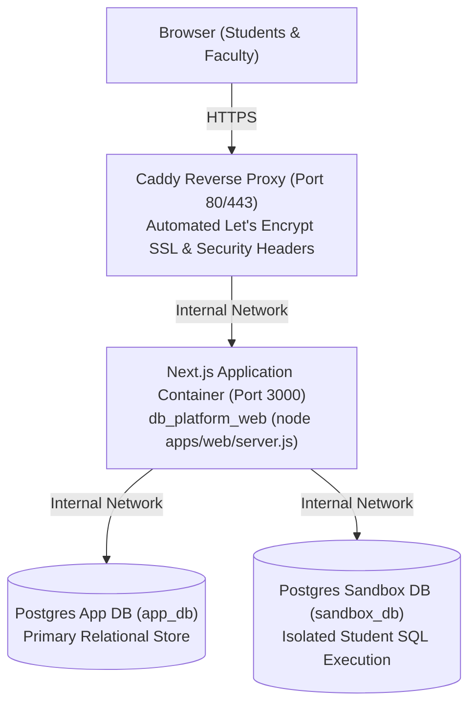

# Docker Production Deployment Guide
## Database Design & Project Learning Platform for Business Analytics

This guide details how to build, deploy, secure, and operate the platform in a production Docker environment.

---

## Architecture Overview



* **Zero External DB Exposure**: PostgreSQL instances are **not** exposed to the public internet. They communicate with the Next.js backend strictly across the private Docker bridge network. Maintenance ports (5432 and 5435) are bound to `127.0.0.1` only.
* **Automated HTTPS**: Caddy automatically provisions and renews TLS certificates from Let's Encrypt for your domain.
* **Resource Quotas & Log Rotation**: Prevents container memory leaks or runaway log files from consuming host disk and CPU.

---

## 1. Quick Start (Production Server)

### Step 1: Clone Repository
```bash
git clone <your-repo-url> /opt/db-platform
cd /opt/db-platform
```

### Step 2: Configure Production Environment
Copy the production environment template:
```bash
cp .env.production.example .env.production
```

Generate secure 32-byte hex secrets:
```bash
openssl rand -hex 32   # Use for JWT_SECRET
openssl rand -hex 24   # Use for POSTGRES_APP_PASSWORD
openssl rand -hex 24   # Use for POSTGRES_SANDBOX_PASSWORD
openssl rand -hex 24   # Use for STUDENT_SANDBOX_PASSWORD
```

Edit `.env.production` and fill in your values and domain name:
```bash
nano .env.production
```
Key variables to verify:
* `APP_DOMAIN`: Your server's fully-qualified domain name (e.g. `analytics.university.edu`).
* `JWT_SECRET`: The generated random secret.
* `POSTGRES_APP_PASSWORD`: Strong password for the application database.
* `POSTGRES_SANDBOX_PASSWORD`: Strong password for sandbox admin.
* `STUDENT_SANDBOX_PASSWORD`: Restricted student role password.
* `AUTO_MIGRATE=true`: Automatically applies schema migrations on startup.
* `AUTO_SEED=true`: Set to `true` on the initial launch to seed the 16-week curriculum and sample cohorts. Set to `false` thereafter.

### Step 3: Build & Launch Containers
```bash
docker compose --env-file .env.production -f docker-compose.prod.yml up -d --build
```

### Step 4: Verify Deployment
Check running container status and health:
```bash
docker compose --env-file .env.production -f docker-compose.prod.yml ps
```
Inspect application startup logs:
```bash
docker compose --env-file .env.production -f docker-compose.prod.yml logs -f web
```

---

## 2. Operational Playbook

### Backing Up the Application Database
Run the provided backup script to generate a timestamped, gzip-compressed snapshot:
```bash
chmod +x ./docker/backup.sh
./docker/backup.sh
```
Backups are saved to `./backups/backup_app_db_YYYYMMDD_HHMMSS.sql.gz` and automatically prune snapshots older than 30 days.

To set up an automated daily backup at 02:00 AM, add a crontab entry:
```bash
crontab -e
# Add line:
0 2 * * * /opt/db-platform/docker/backup.sh >> /var/log/db_backup.log 2>&1
```

### Restoring from Backup
```bash
gunzip < ./backups/backup_app_db_YYYYMMDD_HHMMSS.sql.gz | docker exec -i db_platform_postgres_app psql -U postgres app_db
```

### Pulling Updates & Rebuilding (Zero Downtime)
```bash
git pull origin main
docker compose --env-file .env.production -f docker-compose.prod.yml build web
docker compose --env-file .env.production -f docker-compose.prod.yml up -d --no-deps web
```

### Viewing Logs
```bash
# Follow web application logs
docker compose --env-file .env.production -f docker-compose.prod.yml logs -f web

# Follow Caddy SSL & access logs
docker compose --env-file .env.production -f docker-compose.prod.yml logs -f caddy
```

---

## 3. Production Hardening Checklist

| Security Layer | Implementation | Verification |
| :--- | :--- | :--- |
| **Sandbox Isolation** | `student_sandbox_user` set to `default_transaction_read_only = on` | [init-sandbox.sh](docker/init-sandbox.sh) |
| **SQL Guardrails** | Multi-statement disallowal & transaction breakout prevention | [runner.ts](packages/sandbox/runner.ts) |
| **Port Exposure** | DB ports bound strictly to `127.0.0.1` (loopback only) | [docker-compose.prod.yml](docker-compose.prod.yml) |
| **TLS Encryption** | Automated Let's Encrypt TLS with HSTS and security headers | [Caddyfile](docker/Caddyfile) |
| **Resource Limits** | CPU and RAM limits enforced per container | `docker stats` |
| **Log Management** | `json-file` log rotation with 20MB max-size per file | `docker inspect` |
| **Secret Management** | All credentials injected via `.env.production` | Environment audit |
