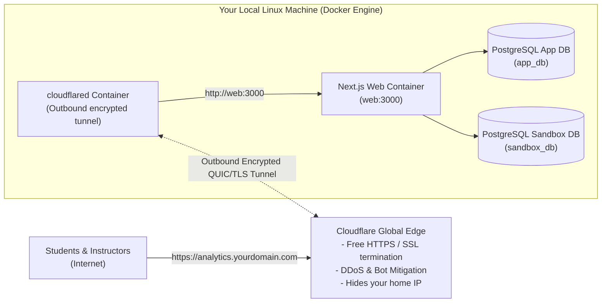

# Linux Docker + Cloud Tunnel Deployment Guide
## Running the Database Learning Platform on a Local Linux Machine via Docker & Cloudflare Tunnel

This guide explains how to run the production Docker stack on a **local Linux computer (Ubuntu, Debian, Fedora, Arch, or home Linux server)** and securely expose it to students and instructors worldwide via a **Cloud Tunnel** — with **no public IP, no router port forwarding, and automatic SSL/TLS encryption**.

---

## 1. Architecture: How It Works



### Why Cloudflare Tunnel for Local Linux Hosting?
* **Zero Router Configuration**: You do **not** need to open port 80 or 443 on your router or firewall.
* **CGNAT Friendly**: Works even if your ISP uses Carrier-Grade NAT (CGNAT) where traditional port forwarding is impossible.
* **IP Privacy**: Your home or campus IP address is never revealed to the public internet.
* **Built-in Free SSL**: Cloudflare terminates HTTPS automatically at the edge with valid certificates trusted by all browsers.

---

## 2. Quickstart: 5-Step Setup

### Step 1: Create a Free Cloudflare Account & Add a Domain
1. In your Cloudflare Dashboard, add your domain and ensure its nameservers point to Cloudflare.

### Step 2: Create a Cloudflare Tunnel
1. Go to the [Cloudflare Zero Trust Dashboard](https://one.dash.cloudflare.com/).
2. In the left sidebar, navigate to **Networks** -> **Tunnels**.
3. Click **Add a tunnel** -> Select **Cloudflared** -> Click **Next**.
4. Name your tunnel (e.g. `db-platform-linux`) and click **Save tunnel**.
5. Under **Install and run a connector**, copy the **Tunnel Token** (the string following `--token`, starting with `eyJhIj...`).

### Step 3: Configure the Public Hostname in Cloudflare
Under the **Public Hostnames** tab of the tunnel:
* **Subdomain**: e.g. `analytics` (or leave blank for root domain)
* **Domain**: `yourdomain.com` (select your domain from dropdown)
* **Path**: leave empty
* **Service Type**: `HTTP`
* **URL**: `web:3000` *(matches the internal Docker service name)*
* Click **Save hostname**.

### Step 4: Configure `.env.production`
Copy `.env.production.example` to `.env.production` and paste your tunnel token:
```bash
cp .env.production.example .env.production
```
Edit `.env.production`:
```env
APP_DOMAIN=analytics.yourdomain.com
JWT_SECRET=generate_with_openssl_rand_hex_32
POSTGRES_APP_PASSWORD=strong_app_db_pw_123
POSTGRES_SANDBOX_PASSWORD=strong_sandbox_db_pw_123
STUDENT_SANDBOX_PASSWORD=strong_student_sandbox_pw_123

# Paste your Cloudflare Tunnel Token here:
CLOUDFLARE_TUNNEL_TOKEN=eyJhIjoi...
```

### Step 5: Launch the Tunnel Stack
Run the Docker Compose command:

```bash
docker compose -f docker-compose.prod.yml -f docker-compose.tunnel.yml --env-file .env.production up -d --build
```

> [!TIP]
> `docker-compose.tunnel.yml` starts the `cloudflared` container and deactivates the local `caddy` service, because Cloudflare edge terminates HTTPS and routes traffic directly into `web:3000`.

Open your browser and navigate to `https://analytics.yourdomain.com` — your platform is live!

---

## 3. Connecting the Tunnel Manually (Host CLI)

If you prefer to start the core Docker containers normally and manage your tunnel **manually from the Linux terminal** (or without adding the tunnel to docker-compose):

First, ensure your application containers are running:
```bash
docker compose -f docker-compose.prod.yml --env-file .env.production up -d --build
```
*(The web container is automatically bound to `127.0.0.1:3000` on your Linux host).*

### Install `cloudflared` on Linux:
* **Ubuntu / Debian**:
  ```bash
  curl -fsSL https://pkg.cloudflare.com/cloudflare-main.gpg | sudo tee /etc/apt/trusted.gpg.d/cloudflare.gpg >/dev/null
  echo "deb [signed-by=/etc/apt/trusted.gpg.d/cloudflare.gpg] https://pkg.cloudflare.com/cloudflared $(lsb_release -cs) main" | sudo tee /etc/apt/sources.list.d/cloudflared.list
  sudo apt-get update && sudo apt-get install -y cloudflared
  ```
* **Arch Linux**:
  ```bash
  sudo pacman -S cloudflared
  ```
* **Standalone Binary (Any Linux distro)**:
  ```bash
  curl -L https://github.com/cloudflare/cloudflared/releases/latest/download/cloudflared-linux-amd64 -o cloudflared
  chmod +x cloudflared && sudo mv cloudflared /usr/local/bin/
  ```

---

### Manual Method A: Instant Quick Tunnel (No Domain, No Account Needed)
Need to test or share a temporary link right now? Cloudflare provides a free instant HTTPS tunnel with one command:
```bash
cloudflared tunnel --url http://localhost:3000
```
This generates a temporary public HTTPS URL instantly:
```text
+--------------------------------------------------------------------------------------------+
|  Your quick Tunnel has been created! Visit it at:                                          |
|  https://random-phrase-abc-123.trycloudflare.com                                           |
+--------------------------------------------------------------------------------------------+
```
Share this URL with students or testers. Press `Ctrl + C` when you are done.

---

### Manual Method B: Run Your Configured Tunnel via CLI
If you created a named tunnel in the Cloudflare Zero Trust dashboard:
1. In Cloudflare Dashboard → Public Hostname → Set URL to `http://localhost:3000`.
2. Run manually in your terminal:
   ```bash
   cloudflared tunnel run --token <YOUR_CLOUDFLARE_TUNNEL_TOKEN>
   ```

---

### Manual Method C: Install as a Persistent Linux `systemd` Service
To have the tunnel run permanently as a Linux background service that starts automatically on boot:
```bash
sudo cloudflared service install <YOUR_CLOUDFLARE_TUNNEL_TOKEN>
sudo systemctl enable cloudflared
sudo systemctl start cloudflared
```
To check status:
```bash
sudo systemctl status cloudflared
```

---

### Manual Method D: Manual Docker Run (Single Command)
If you prefer not to install `cloudflared` on the host system, run it as a standalone container:
```bash
docker run --rm -it --network host cloudflare/cloudflared:latest tunnel --no-autoupdate run --token <YOUR_CLOUDFLARE_TUNNEL_TOKEN>
```
*(Using `--network host` connects the container directly to `http://localhost:3000` on your Linux host).*

---

### Manual Method E: Using `ngrok` (Alternative)
```bash
ngrok http 3000
```

---

## 3. Crucial Local Linux Host Optimization Checklist

Running on a local Linux computer or laptop requires simple Linux systemd adjustments to prevent downtime:

### 1. Prevent Linux Sleep & Suspends (P0 Essential)
If your Linux system suspends or sleeps, the tunnel and web app drop immediately.

* **Disable Suspend and Sleep in systemd**:
  ```bash
  sudo systemctl mask sleep.target suspend.target hibernate.target hybrid-sleep.target
  ```
  *(To undo later if needed: `sudo systemctl unmask sleep.target suspend.target hibernate.target hybrid-sleep.target`)*

* **If running on a Linux Laptop (Prevent Lid Close Sleep)**:
  Edit `/etc/systemd/logind.conf`:
  ```ini
  HandleLidSwitch=ignore
  HandleLidSwitchExternalPower=ignore
  ```
  Then restart `systemd-logind`:
  ```bash
  sudo systemctl restart systemd-logind
  ```

### 2. Ensure Docker Starts Automatically on Linux Boot
Ensure Docker daemon starts automatically whenever the Linux computer turns on or reboots:
```bash
sudo systemctl enable docker
sudo systemctl start docker
```
Because all services in `docker-compose.prod.yml` and `docker-compose.tunnel.yml` have `restart: unless-stopped` or `restart: always`, all database, web, and tunnel containers will automatically launch on system boot.

### 3. Reliable Network Connection
- Plug your Linux machine into a wired **Ethernet cable** rather than Wi-Fi to eliminate packet drops and latency spikes during simultaneous student submissions.

---

## 4. Automated Backups & Maintenance

### 1. In-Container Backups (Automatic & Zero Setup)
The Docker stack includes an automated `backup` container service that starts with your application:
* **Automatic**: Runs daily at 02:00 AM inside Docker with zero host crontab configuration needed.
* **Storage**: Dumps are saved directly to `./backups` on your Linux machine with 30-day auto-retention.
* **Manual Backup**: Trigger anytime with `docker compose exec backup backup-service.sh`.
* **View Logs**: Monitor with `docker logs -f db_platform_backup`.

### 2. Optional: Host-Level Weekly Docker Pruning
To prevent old Docker image layers and build cache from accumulating on your Linux disk, install the weekly cleanup cron:
```bash
chmod +x ./docker/*.sh
./docker/setup-cron.sh
```

### Optional: Offsite Backup to AWS S3 or Cloudflare R2
If you set `S3_BUCKET` in `.env.production`:
```env
S3_BUCKET=my-university-analytics-backups
```
`docker/backup.sh` will automatically sync compressed backups offsite to S3/R2 after every local dump.

---

## 5. Verification & Health Monitoring

Once your Linux stack and tunnel are running:

1. **Check Tunnel Connection**:
   ```bash
   docker logs -f db_platform_tunnel
   ```
   You should see: `Registered tunnel connection ... Connection established to Cloudflare edge server`.

2. **Verify Public Endpoint**:
   ```bash
   curl -s https://analytics.yourdomain.com/api/health
   ```
   Expected output:
   ```json
   {
     "status": "healthy",
     "timestamp": "2026-11-18T...",
     "uptime": 45.2,
     "databases": {
       "app_db": { "status": "connected", "latency_ms": 2.1 },
       "sandbox_db": { "status": "connected", "latency_ms": 1.8 }
     }
   }
   ```

3. **Check Running Containers**:
   ```bash
   docker compose -f docker-compose.prod.yml -f docker-compose.tunnel.yml ps
   ```
